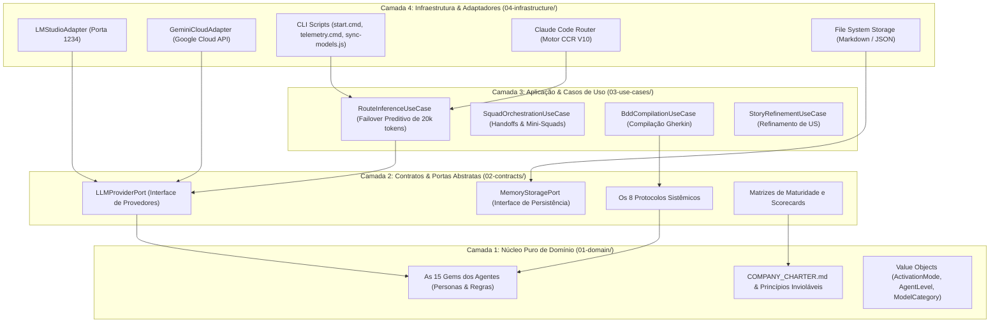

<div align="center">

# 🧅 Feltrim Agents Onion

### *Cognitive Multi-Agent Framework · 4-Layer Onion Architecture · Clean Code*

[](#-as-4-camadas-da-cebola)
[](#-auditoria-de-qualidade-e-testes-sdet)
[](#-adaptadores-de-infraestrutura)
[](#-adaptadores-de-infraestrutura)
[](#-adaptadores-de-infraestrutura)
[](#-governança-e-decisor-humano)

<p align="center">
  <strong>Implementação desacoplada do Feltrim Agents Framework (FF) segundo a Arquitetura de Cebola (Jeffrey Palermo / Clean Architecture). O domínio cognitivo dos agentes e a governança são 100% isolados de bibliotecas de rede, SO e APIs de modelos externos.</strong>
</p>

[Quick Commands](#-quick-commands-da-pasta-onion) •
[As 4 Camadas](#-as-4-camadas-da-cebola) •
[Casos de Uso](#-casos-de-uso-e-auto-failover) •
[Auditoria QA](#-auditoria-de-qualidade-e-testes-sdet) •
[Governança](#-governança-e-decisor-humano)

</div>

---

## ⚡ Quick Commands da Pasta Onion

Estando dentro da pasta `feltrim-agents-onion/`, todos os atalhos operacionais estão prontos:

| Comando | Ação | Parâmetros e Exemplos |
| :--- | :--- | :--- |
| `.\start.cmd` | **Inicia a sessão interativa do Claude Code**. Verifica ambiente, checa saúde dos modelos, inicia o Router V10 oculto na porta 3456 e conecta a CLI. | Padrão interativo |
| `.\start.cmd -Model "<id>"` | Inicia direto no modelo desejado sem abrir o menu de seleção. | Ex: `.\start.cmd -Model "qwen2.5-coder-7b-instruct"` ou `.\start.cmd -Model "gemini-3.5-flash-lite"` |
| `.\start.cmd -Auto` | Modo autônomo com permissão de edição segura de código (`acceptEdits`). | Edição ágil de código |
| `.\start.cmd -Task "<prompt>"` | Executa uma tarefa pontual e desliga a sessão após finalizar. | Ex: `.\start.cmd -Task "Crie um teste unitário para X"` |
| `.\start.cmd -PrepContext` | Pré-processa e compacta o contexto do repositório via Graphify + Gemini. | Otimização de tokens |
| `.\telemetry.cmd` | Exibe o status consolidado do Router (3456), LM Studio (1234) e modelo ativo. | Snapshot estático |
| `.\telemetry.cmd -f` | **Streaming contínuo de logs em tempo real** (`--follow`) com latências, tokens/s e failover. | Monitoramento live |
| `node tests/rafael_qa_suite.js` | Executa a suíte completa de **20 testes automatizados** do Rafael QA por Core, Módulos e Submódulos. | 100% Green em 50ms |

---

## 🧅 As 4 Camadas da Cebola

A arquitetura organiza todas as dependências apontando rigorosamente para o **Centro de Domínio** (DIP - Dependency Inversion Principle):



### 1. `01-domain/` - Núcleo Puro (Core Domain)
- **`agents/`**: As 15 Gems canônicas dos agentes (`gem_sofia_ciao.md`, `gem_beatriz_tl.md`, `gem_rafael_qa.md`, etc.).
- **`governance/`**: Carta da empresa (`COMPANY_CHARTER.md`), organograma formal e políticas de certificação.
- **`value-objects/`**: Objetos de valor imutáveis (`ActivationMode`, `AgentLevel`, `ModelCategory`).
- *Regra Clean Code*: Zero dependências de rede, SO, bibliotecas terceiras ou ferramentas externas.

### 2. `02-contracts/` - Contratos e Portas Abstratas (Ports)
- **`ports/llm-provider.port.js`**: Interface formal que todo adaptador de IA deve assinar (`generateCompletion`, `streamCompletion`, `checkHealth`).
- **`ports/memory-storage.port.js`**: Interface abstrata para leitura e escrita de memória de agentes.
- **`protocols/`**: Os 8 Protocolos Sistêmicos (`AGENT_IO_CONTRACT.md`, `HANDOFF_PROTOCOL.md`, etc.).

### 3. `03-use-cases/` - Casos de Uso da Aplicação (Application Services)
- **`failover-routing/route-inference.use-case.js`**: Orquestra onde a inferência é executada:
  - Estima o volume de tokens via densidade de caracteres.
  - Se > 20.000 tokens, direciona para o Cloud Provider (Gemini com 1M de janela).
  - Se < 20.000 tokens, valida a saúde local e executa no LM Studio.
  - Se o LM Studio falhar ou estiver offline, aciona o **Auto-Failover Transparente** para a Cloud.

### 4. `04-infrastructure/` - Adaptadores Concretos (Adapters & Tools)
- **`llm-adapters/`**: Implementações concretas de `LLMProviderPort` (`LMStudioAdapter` e `GeminiCloudAdapter`).
- **`router/`**: Motor CCR com o Patch V10 (Anti-Opus Identity Guard e prevenção de quebra de SSE stream).
- **`cli/`**: Automação PowerShell e Node.js (`start-claude-multi.ps1`, `telemetry.ps1`, `sync-models.js`).

---

## 🛡️ Auditoria de Qualidade e Testes SDET

A robustez da arquitetura é verificada por uma bateria de **20 testes automatizados**, segmentados por Core, Módulos e Submódulos:

```text
================================================================================
📊 RESUMO DA AUDITORIA POR NÍVEL HIERÁRQUICO (rafael_qa_suite.js):
--------------------------------------------------------------------------------
   🟢 Core Framework (9 Submódulos) | 9/9 testes (100%)
   🟢 cms-gherkin    (5 Submódulos) | 5/5 testes (100%)
   🟢 cvp-sias-qa    (4 Submódulos) | 4/4 testes (100%)
   🟢 us-avaliator   (2 Submódulos) | 2/2 testes (100%)
--------------------------------------------------------------------------------
   TOTAL DE TESTES GARANTIDOS: 20
   APROVADOS: 20 🟢 | FALHAS: 0 🎉 | TAXA DE QUALIDADE: 100.0%
================================================================================
```

Para rodar a auditoria diretamente desta pasta:
```powershell
node tests/rafael_qa_suite.js
```

---

## ⚖️ Governança e Decisor Humano

- **Decisor Humano Final:** **Rafael Feltrim**.
- **Mantra Cultural:** *"Unity, Tradition, Pride, and Equity"*.
- **Veto Técnico:** **Sofia (CIAO - N5)**, encarregada da auditoria contínua de guardrails e adesão aos 8 protocolos.
- **Relatório Oficial de Auditoria:** Arquivado e assinado em [`01-domain/governance/relatorio_rafael_qa_auditoria_onion.md`](file:///c:/Users/RafaelFeltrim/OneDrive%20-%20Foursys/Área%20de%20Trabalho/Projetos/Feltrim-Agents-Company/feltrim-agents-onion/01-domain/governance/relatorio_rafael_qa_auditoria_onion.md).

---

<div align="center">
  <sub>Feltrim Agents Onion · Clean Architecture Edition · <strong>Rafael Feltrim</strong> · 2026</sub>
</div>
